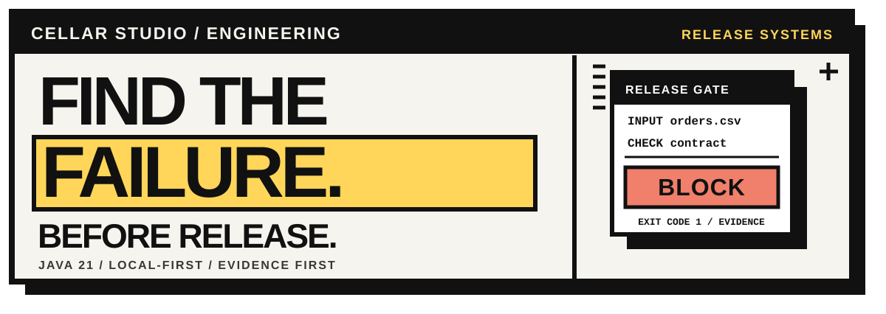
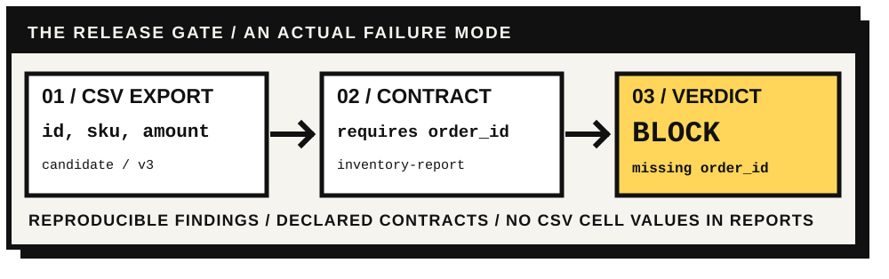

<p align="center"></p>

<h1 align="center">CELLAR STUDIO</h1>

<p align="center"><strong>ENGINEERING TOOLS / BUILT FOR THE BREAKING POINTS</strong></p>

<p align="center"></p>

<p align="center">Developer tools for the fragile boundaries between data, builds, storage, and software systems.</p>

<p align="center">
  <a href="https://cellar-studio-hq.vercel.app/">Company website</a> ·
  <a href="https://cellar-csv.vercel.app/">Cellar Guard</a> ·
  <a href="https://cellar-studio-hq.vercel.app/explore.html">Product briefs</a> ·
  <a href="docs/README.md">Documentation</a> ·
  <a href="CONTRIBUTING.md">Contribute</a>
</p>

<p align="center"><sub>JAVA 21+ &nbsp; / &nbsp; LOCAL-FIRST &nbsp; / &nbsp; EVIDENCE-DRIVEN &nbsp; / &nbsp; MIT LICENSED</sub></p>

---

| **01 / DISCOVER** | **02 / RUN THE TOOL** | **03 / BUILD WITH US** |
| :--- | :--- | :--- |
| [Explore the product lineup](#explore-the-products) | [Start Cellar Guard locally](#quick-start) | [Develop & verify](#build-and-test) |

---

## What is Cellar Studio?

**Cellar Studio** is the parent company identity and public home for a growing set of developer-infrastructure tools. Each product tackles one failure mode and aims to answer four questions:

1. **What failed?** Name the broken contract, invariant, or dependency.
2. **Where is the evidence?** Make the result reproducible and inspectable.
3. **Who or what is affected?** Explain the impact in practical terms.
4. **What happens next?** Provide a useful fix, safe migration, or release decision.

The Studio website is a product directory and documentation experience. It is **not** a unified account system or a production backend for every listed project.

### The structure today

| Layer | Purpose | Current state |
| --- | --- | --- |
| **Cellar Studio** | Company home, product directory, project documentation and common visual language | Live website |
| **Studio products** | Independent tools with their own code, maintainers and release schedules | Mixed maturity; see below |
| **Studio Labs** | Systems research with testable hypotheses and reproducible experiments | Research and prototypes |
| **Shared platform** | Common identity, reports, permissions and cross-product workflows | Planned; not deployed |

This repository was renamed from **Cellar** to **Cellar-Studio**. It still contains the complete **Cellar Guard** Java implementation. A separate child repository for Guard is a future migration, not a completed split. Read the [repository hierarchy](docs/REPOSITORY_HIERARCHY.md) before moving code or changing ownership.

## Explore the products

| Project | The problem it tackles | Status | Explore |
| --- | --- | --- | --- |
| **Cellar Guard** | CSV exports silently break downstream imports when columns or contracts change | **Working pilot** — Java checker, CLI and local web workspace | [Live demo](https://cellar-csv.vercel.app/) |
| **Deadlock Sentinel** | Circular waits in JVM thread dumps are difficult to diagnose | **Java prototype / research demo** | [Trace explorer](https://cellar-studio-hq.vercel.app/deadlock.html) · [Run locally](products/deadlock-sentinel/README.md) |
| **BuildClinic** | Build failures are buried in noisy logs | Early-stage standalone tool | [Product brief](https://cellar-studio-hq.vercel.app/explore.html#buildclinic) |
| **ClauseCraft** | Teams need an explainable first pass over risky document patterns | Prototype, not legal advice | [Product brief](https://cellar-studio-hq.vercel.app/explore.html#clausecraft) |
| **PlanCliff** | Database query plans can regress when data distributions change | Research | [Research brief](https://cellar-studio-hq.vercel.app/explore.html#plancliff) |
| **CrashCheck** | SQLite-backed apps can violate assumptions after abrupt termination | Storage research | [Research brief](https://cellar-studio-hq.vercel.app/explore.html#crashcheck) |
| **Cellar Learn** | Difficult engineering concepts need clearer interactive explanations | Candidate / exploratory | [Product brief](https://cellar-studio-hq.vercel.app/explore.html#learn) |

**Status labels matter:** a product appearing on the Studio website does not mean it has a production API, shared login, hosted backend, or completed integration with other products. Independent repositories retain their own licenses and contributors.

## Try Cellar Guard

Cellar Guard checks CSV files against declared contracts **before** a release. For example, a customer import expects `order_id`, but a new export renames it to `id`:

<p align="center"></p>

```text
FAIL  inventory-report  requires order_id
PASS  finance-summary   satisfies its contract
Triage: "order_id" may have been renamed to "id".
Verdict: do not ship.                         (exit code 1)
```

The [public Guard website](https://cellar-csv.vercel.app/) includes **synthetic demonstrations and sample reports**. It does not run the complete Java backend. To upload your own CSV, edit contracts or keep local run history, start the Java application.

<a id="quick-start"></a>

### Run the real application locally

Prerequisite: **JDK 21 or newer**. No Maven, Gradle, npm installation, account, or API key is required for the core checker.

**macOS / Linux**

```sh
git clone https://github.com/suryandugy-glitch/Cellar-Studio.git
cd Cellar-Studio
sh run.sh
```

**Windows (PowerShell)**

```powershell
git clone https://github.com/suryandugy-glitch/Cellar-Studio.git
cd Cellar-Studio
.\run.bat
```

The launcher builds `dist/cellar.jar` if needed and starts the local web workspace. Open the address printed in the terminal (usually **http://127.0.0.1:8080**; a free port is selected if 8080 is occupied).

1. Select **Check → Breaking demo → Run check**.
2. Inspect the inventory failure, finance pass and suggested migration.
3. Open **Contracts** to edit rules or use **Scout** to draft a contract from a sample.

Local data is stored under the ignored `data/` directory. **Do not commit customer CSVs, API keys or local data files.**

### Use the CLI

After `java Build.java test` or `java Build.java package` has created the JAR:

```sh
java -jar dist/cellar.jar export-demo --out build/sales.csv
java -jar dist/cellar.jar check --csv build/sales.csv --summary --format markdown
java -jar dist/cellar.jar validate
```

The checker uses exit code **0** for allowed results, **1** for blocked releases and **2** for invalid input or usage errors. See the [contract format](docs/CONTRACTS.md), [CLI and operations guide](docs/OPERATIONS.md), and [API reference](docs/API.md).

### Use it in CI

The same checker can stop a release when a synthetic or generated export violates a contract:

```yaml
name: csv-contract-check
on: pull_request
permissions: { contents: read }
jobs:
  check:
    runs-on: ubuntu-latest
    steps:
      - uses: actions/checkout@v4
      - uses: actions/setup-java@v4
        with: { distribution: temurin, java-version: '21' }
      - run: java Build.java package
      - run: java -jar dist/cellar.jar export-demo --out build/sales.csv
      - run: java -jar dist/cellar.jar check --csv build/sales.csv --summary --format markdown
```

Replace the demo export with a **synthetic fixture generated by your own exporter**. The example does not test real production data or post GitHub comments automatically.

### What you get

- **Validation:** required columns, data types, numeric ranges, allowed values, uniqueness, not-empty rules and row limits.
- **Change detection:** schema differences, suspected renames, contract revisions, restoration and drift against a passing baseline.
- **Release workflow:** clear pass/block verdicts, CLI/CI exit codes, downloadable Markdown/JSON reports and an activity history.
- **Local automation:** inbox monitoring, contract scouting and offline rule-based explanations.
- **Optional AI assistance:** metadata-based explanations when the operator configures their own provider key. It is off by default; CSV cell values are not sent to the AI provider.

Guard produces findings against the rules you declare; a successful check is **not** a guarantee that every downstream system will accept every value. There is no shared multi-tenant SaaS or SSO in this repository today.

<a id="build-and-test"></a>

## Develop and verify

| Work area | Source | Verification |
| --- | --- | --- |
| Java checker, CLI and HTTP API | `src/main/java/` | `java Build.java test` |
| Java tests | `src/test/java/` | `java Build.java test` |
| Web UI served by Java | `src/main/resources/web/` | Java tests and a manual local browser check |
| Studio / Guard static pages | `deploy/pages/` | `sh deploy/build-pages.sh` |
| Vercel packaging and routing | `deploy/build-vercel.mjs`, `vercel.json` | `node deploy/build-vercel.mjs` |
| Deadlock Sentinel prototype | `products/deadlock-sentinel/` | [Prototype tests](products/deadlock-sentinel/README.md#test) |
| Architecture and operating docs | `docs/` | [Documentation index](docs/README.md) |

Run the core tests:

```sh
java Build.java test
sh deploy/build-pages.sh
node deploy/build-vercel.mjs
```

The build outputs (`dist/` and `build/`) are generated artifacts. The GitHub **Backend** and **Website** workflows provide the pull-request checks; see the [contribution guide](CONTRIBUTING.md) for the expected review process.

New contributors can use [GitHub Codespaces](docs/DEVELOPMENT_ENVIRONMENT.md) or a local JDK. No genuine customer data is needed to reproduce the examples.

<a id="share-it-on-a-server"></a>
<a id="deploy-the-site-and-connect-the-workspace"></a>

## Deployment boundaries

| Component | Deployment | Important distinction |
| --- | --- | --- |
| [Cellar Studio](https://cellar-studio-hq.vercel.app/) | Vercel static website | Company pages, product briefs and demonstrations |
| [Cellar Guard](https://cellar-csv.vercel.app/) | Vercel static demonstration, using the same web build | Synthetic examples; not the persistent Java workspace |
| Guard Java workspace | Local machine or separately provisioned Java host | Real CSV checks, contract editing, history and API |

Vercel uses `vercel.json` and `node deploy/build-vercel.mjs` to build the public pages. The Guard-specific hostname opens `/guard.html`; the Studio hostname opens the company homepage.

A shared Java deployment requires HTTPS, origin restrictions and server-side keys. Configure the Java host first; connect a separate frontend only with the documented origin settings. **Do not place `CELLAR_ACCESS_KEY` or `CELLAR_MASTER_KEY` in public frontend code.** Follow [security and deployment](docs/WEB_SECURITY.md) and [operations](docs/OPERATIONS.md). The optional AI key remains server-side.

## No hype. Honest limits.

- The public website is a static demonstration. Uploading and storing your own CSV requires the Java workspace.
- Guard is a **working pilot**, not a multi-tenant production SaaS or an independently audited security product.
- A passing CSV check only proves that the **declared** rules passed. It does not prove the meaning or correctness of every data value.
- Studio's shared login, organization permissions, unified report backend and cross-product orchestration are **not implemented**.
- Research products must publish reproducible evidence before they can be described as production-ready.

<a id="roadmap"></a>

## Roadmap and governance

- **Now:** keep Guard verifiable, improve the Studio product experience, and maintain honest documentation and tests.
- **Next:** versioned report interchange, stronger CI integrations, and reproducible benchmarks for research tools.
- **Later:** opt-in shared accounts, project-level permissions and cross-product workflows, subject to security review.

Company-level decisions and the current core ownership are documented in [core governance](docs/CORE_GOVERNANCE.md). This is a **public repository**: CODEOWNERS and a public governance file do not make internal information private or revoke GitHub access. Keep confidential operations in a separately access-controlled location.

### Documentation

| Start here | Deeper technical references |
| --- | --- |
| [Getting started](docs/GETTING_STARTED.md) | [High-level design](docs/HLD.md) · [Low-level design](docs/LLD.md) |
| [Company roadmap](docs/CELLAR_STUDIO.md) | [Product requirements](docs/PRD.md) · [Repository hierarchy](docs/REPOSITORY_HIERARCHY.md) |
| [Codebase map](docs/CODEBASE_MAP.md) | [Contracts](docs/CONTRACTS.md) · [API](docs/API.md) |
| [Contribution guide](CONTRIBUTING.md) | [Security](SECURITY.md) · [Deployment](docs/WEB_SECURITY.md) |

<a id="contributing"></a>

## Contributing and license

Issues, bug reports and focused pull requests are welcome. Include a reproducible synthetic example, describe the affected product, explain tests and limitations, and preserve existing contributors' attribution. See [CONTRIBUTING.md](CONTRIBUTING.md).

Licensed under the [MIT License](LICENSE). See [CHANGELOG.md](CHANGELOG.md) for release history.
