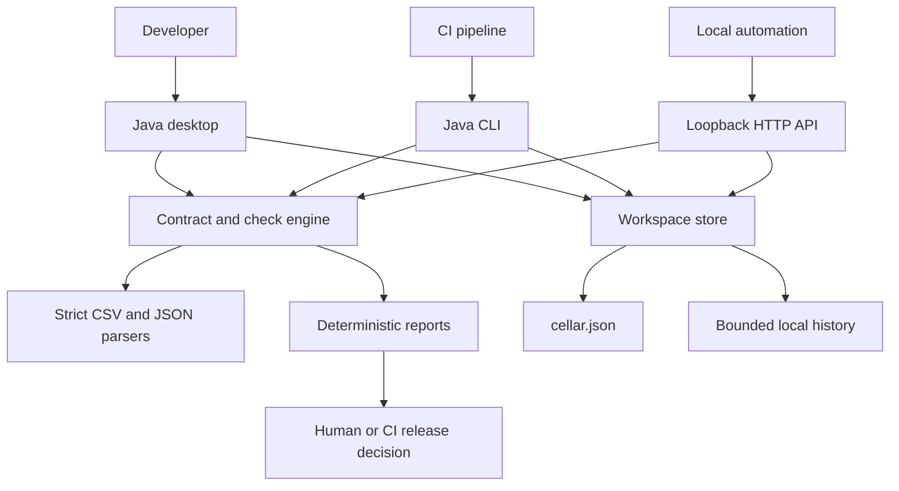
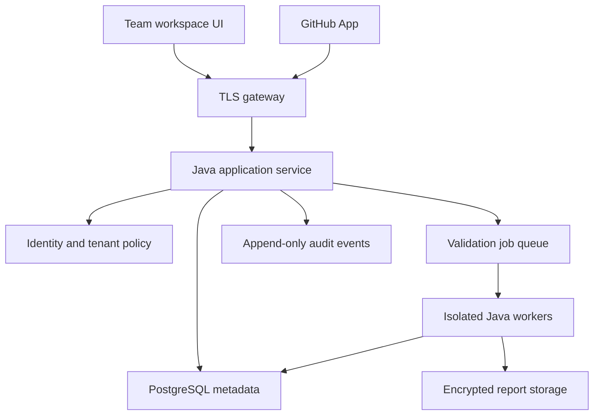

# High-level design

> **Note (3.0.0-web.1):** this document describes the 2.0 desktop/loopback design. The product is now a hardened web application; see `README.md` and `docs/WEB_SECURITY.md`. The validation engine described here is unchanged.

**System:** Cellar 2.0.0-beta.1. **Decision:** deliver a local Java product and CI gate first; build hosted collaboration only after paid pilot evidence. This document separates implemented architecture from proposed cloud architecture.

## 1. Product boundary

Cellar consumes a UTF-8 CSV fixture and a versioned JSON contract describing downstream integrations. It returns per-integration findings and a release decision. It does not run a customer's exporter, connect to production data, contact integration owners or prove compatibility beyond declared rules. CI owns fixture generation; humans own migration approval.

## 2. Implemented system

All components run in one JVM per invocation. CLI, desktop and server are alternative entry points to the same pure validation engine. Desktop uses the engine directly, avoiding a server dependency. The API binds only `127.0.0.1`, and every endpoint requires a bearer token. There is no outbound networking in the application.

### Components and responsibilities

| Component | Responsibility | External interface |
|---|---|---|
| Desktop | Select/drop CSV, edit/save contracts, compare headers, inspect history, export reports | Swing native window |
| CLI | Validate arguments, read files, render results, set exit code | Terminal, GitHub summary |
| API | Authenticate, validate HTTP envelope, call services, map errors | Six `/api/*` routes |
| Contract model | Validate strict configuration and retain ordered rules | JSON |
| Check engine | Compute findings, severity and gate status | In-memory result map |
| Parsers | Enforce input grammar and resource bounds | UTF-8 strings |
| Workspace store | Revision-guarded contract writes, rolling history, file locking | Local filesystem |

## 3. Data lifecycle

1. Read bounded bytes and reject invalid UTF-8.
2. Parse and validate the complete contract before checking data.
3. Parse header only for legacy contracts; parse all rows when row rules/counts exist.
4. Evaluate every named integration in declared order. Never include cell values in findings.
5. Emit a deterministic report with contract hash. Desktop/API persist a smaller summary; CLI opts in with `--record`.
6. Retain only the latest 100 summaries. CSV source files are neither copied nor uploaded by the app.

Owner names, contract configuration, header names and integration IDs can be sensitive. A user may explicitly export a report to any selected local path. Privacy boundaries must consider those files as well as `.cellar/history.json`.

## 4. Deployment

### Developer machine

Java 21+ runtime, full GUI environment for Swing, extracted release folder, read access to CSV/config and write access to the workspace. No database or network account. `run.bat` / `run.sh` launches the desktop; CLI can run independently.

### CI runner

JDK 21, checkout, `java Build.java test`, real synthetic exporter, then `check --summary`. Use read-only repository permissions. Runtime data/history need not persist; archive a redacted report if the team needs one. The workflow is code, but required status checks and ownership rules are repository settings that must be configured separately.

### Local API process

Same JAR, `serve`, optional private `CELLAR_API_TOKEN`, loopback port 8765. Default token is random per process. No TLS or remote account service is supplied because remote clients are outside this release's deployment boundary. Do not publicize the service through a tunnel or proxy.

## 5. Nonfunctional requirements and current limits

| Area | Implemented control | Remaining work |
|---|---|---|
| Correctness | Strict inputs, shared engine, deterministic findings, automated regression/API tests | Independent parser fuzzing and larger production-derived synthetic fixtures |
| Resource use | 8 MiB input, 100k rows, 1k columns, 100 integrations, 200 retained issues/integration | Profile worst-case memory and workload combinations |
| Desktop responsiveness | Worker threads for checks and IO | Manual DPI, accessibility and OS validation |
| API concurrency | 8 workers, 4 active accepted handlers, bounded requests | Public-service rate limiting and hardened transport if hosted later |
| Reliability | Atomic replacement where supported, file lock, optimistic revision checks | Crash/power-loss tests; filesystem durability beyond rename |
| Privacy | No outbound telemetry; no cell values in reports/history | Encryption at rest, customer retention policy for a cloud product |
| Auditability | Contract hash and recent summary history | Actor identity, signatures, immutable audit and approvals |

The file size limit is not a memory guarantee: parsed objects, Unicode strings, uniqueness sets and concurrent requests add overhead. Keep an initial API pilot to small fixtures and a trusted local caller. The fixed HTTP pool is not a complete denial-of-service defense; stalled requests can occupy workers. Do not represent this API as internet ready.

## 6. Proposed hosted architecture — not implemented

Only start this phase when at least two real teams use Cellar repeatedly and one commits to paying for shared collaboration.

Prefer a modular Java monolith for account, repository, contract, run and billing metadata. Keep the current checker as an isolated deterministic library. Add a queue/worker boundary only when job duration or concurrency warrants it. Do not deploy many microservices simply for an architecture diagram.

### Hosted requirements

- Tenant-scoped access on every record and request, tested across organizations.
- Managed identity or reviewed authentication; roles: owner, maintainer, viewer.
- GitHub installation tokens with least privilege and verified webhook signatures.
- Signed, expiring upload grants; explicit decision whether CSV data may leave a customer's runner.
- Prefer running checks in CI and uploading only signed summaries/contract metadata where possible.
- Idempotent run creation, bounded retries, timeout/cancellation, dead-letter review.
- Contract revisions and migrations with human approvals and actor identity.
- Database backups, tested restore, encryption keys, deletion/retention controls, observability.
- Payment provider integration and usage enforcement after a paid pilot validates packaging.

## 7. Architectural decisions

| Decision | Why now | Revisit when |
|---|---|---|
| Java 21 baseline | Matches the requested Java migration, standard desktop and HTTP APIs | Supported deployment environments change |
| Swing desktop | Entire application including UI stays Java and runs offline | Customers demand browser/team access |
| No runtime libraries | Straightforward offline execution and small artifact | Parser maintenance/security review favors established libraries |
| JSON files locally | Simple inspectable single-user state | Multi-user coordination, queries or large retention becomes necessary |
| Advisory onboarding | Allows teams to measure noise before blocking merges | Pilot owner accepts enforcement |
| No AI in core checking | Explicit contracts produce repeatable evidence | Optional suggestions show measurable value without changing deterministic gates |

## 8. Technical references

Primary documentation consulted 2026-11-15:

- [Java 21 API](https://docs.oracle.com/en/java/javase/21/docs/api/index.html)
- [Java desktop module](https://docs.oracle.com/en/java/javase/21/docs/api/java.desktop/module-summary.html)
- [JDK HTTP server module](https://docs.oracle.com/en/java/javase/21/docs/api/jdk.httpserver/module-summary.html)
- [GitHub workflow syntax and permissions](https://docs.github.com/en/actions/reference/workflows-and-actions/workflow-syntax)
- [setup-java action](https://github.com/actions/setup-java)

These sources establish the platform capabilities. The architecture and resource allocations above are project design choices, not vendor guarantees.
