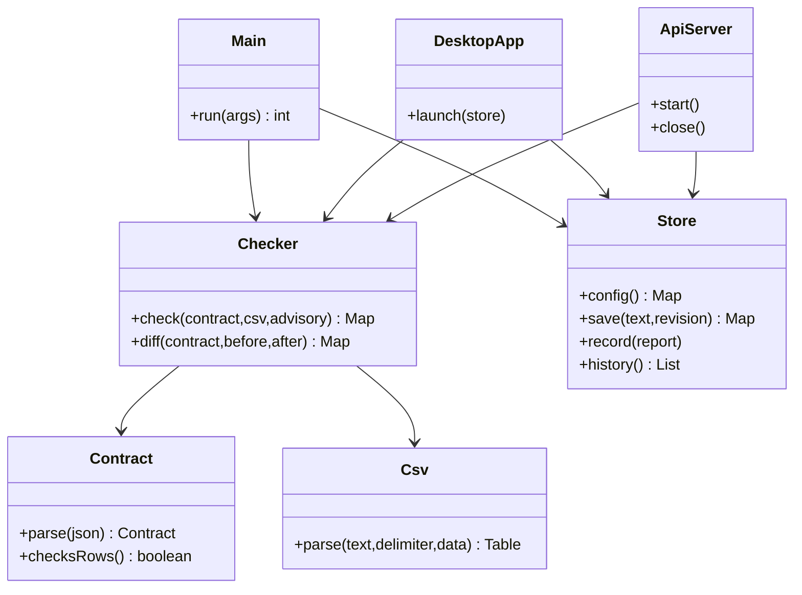
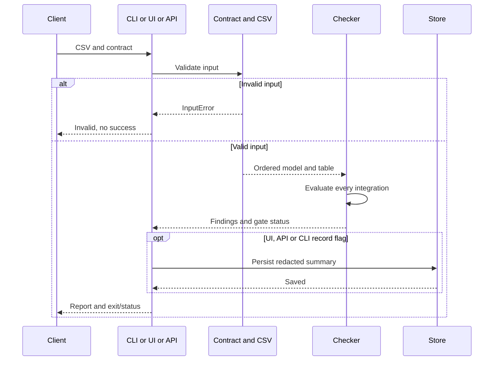
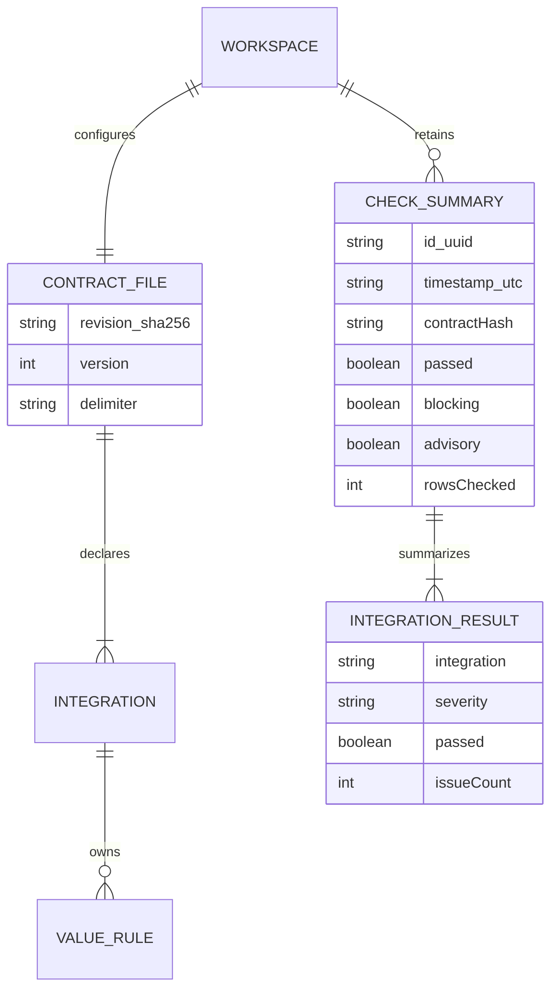

# Low-level design

> **Note (3.0.0-web.1):** this document describes the 2.0 desktop/loopback design. The product is now a hardened web application; see `README.md` and `docs/WEB_SECURITY.md`. The validation engine described here is unchanged.

This describes the shipped source in `src/main/java/io/cellar`. All production classes use package `io.cellar`. `Build.java` is a standalone build tool.

## Class relationships

### Supporting classes

| Class | Contract |
|---|---|
| `Json` | Strict recursive-descent JSON parser; ordered object writer; duplicate keys rejected; max nesting 64 and numeric token 128 characters |
| `FilesEx` | Bounded UTF-8 read/decode, atomic file replacement, SHA-256 string fingerprint |
| `Reports` | Text/Markdown renderers; escape Markdown/HTML metadata in summary |
| `Demo` | Synthetic exporter fixture and v2 starter contract |
| `InputError` | Invalid data/configuration/operation exception; CLI exit 2 and HTTP 400 |

## Domain records

`Contract(integrations, delimiter, canonical)` contains an immutable list of integration records and a canonical compact representation used for hashing.

`Integration(id, owner, description, severity, required, allowed, order, rules, minRows, maxRows)` retains declared order. Lists are immutable and rule maps are insertion-ordered and unmodifiable.

`Rule(type, notEmpty, unique, values, min, max)` represents a value contract. `BigDecimal` handles exact numeric bounds. Default type is string. Config parser rejects invalid types, contradictory numeric/row bounds, unknown properties and rules for columns not listed as required.

`Csv.Table(header, rows)` is an immutable snapshot. Legacy mode returns an empty rows list even when the input has data; report `scope` disambiguates this.

Result maps are used at the serialization boundary instead of custom serializers. They are created and owned per request; the engine has no shared mutable state.

## Check sequence

Persistence errors fail the operation instead of silently claiming history was saved. CLI without `--record` is independent of history availability. A report file is written only after requested history persistence succeeds. A successful HTTP check uses 200 even when the compatibility gate blocks; callers inspect `blocking`.

## Algorithms and complexity

Let B=input bytes, H=header columns, R=data rows, I=integrations, K=total value rules across integrations, F=retained findings.

1. `FilesEx.read` reads at most 8 MiB + one byte, rejects excess, then decodes with malformed/unmappable UTF-8 reporting.
2. `Csv` uses a state machine: unquoted, quoted, closed quote. It accepts escaped `""`, embedded newline in quoted fields, LF/CRLF/CR record endings and one leading BOM. Quotes inside unquoted fields and characters after closing quotes fail.
3. Header validation rejects blanks, duplicates and control characters. Column positions are indexed once with a hash map.
4. Required-column presence checks use that map. Optional `allowed` membership uses a list; optional `order` compares the complete list.
5. For each configured rule, iterate rows, check empty semantics, optionally populate a uniqueness set, then type/enum/bounds.
6. Keep the first 200 findings per integration while continuing to count all findings. Invalid types skip further enum/bounds for that cell.
7. Gate is derived from severity and advisory. Ordering is deterministic; reports contain no timestamp/random IDs. History adds these separately.

CSV parsing is O(B). Core presence checks are roughly O(total required columns). Row validation is O(R × K), plus list-based enum membership costs. Allowed-column checks are O(I × H × allowed-list-size) in the worst case. Memory includes decoded input, parsed cells, per-rule uniqueness values and O(F). Uniqueness sets are discarded after each rule. Large repeated rules across many integrations increase CPU; current bounds are safety caps, not performance targets.

## Local persisted model

This is a logical model, **not** a relational database in this release. `cellar.json` is the contract. `.cellar/history.json` is a JSON array newest first, max 100 entries. `.cellar/workspace.lock` coordinates app mutations. History omits header, owner, cell values, individual issues and source filenames. It retains integration IDs and contract hash. No contract revision content is reconstructed from the hash; keep contracts in Git for that.

## Writes and concurrency

- `Store.save`: parse new contract first → acquire workspace file lock → reread current config → compare SHA-256 of exact original text with expected revision → write temp file in same directory → atomic replace when supported → return new revision.
- `Store.record`: acquire same lock → parse current history → prepend metadata summary → keep first 100 → replace file. Malformed history is not overwritten.
- Lock contention returns an actionable retry error; it does not wait indefinitely.
- GUI uses Swing workers for IO/checks; one operation at a time within the app. It snapshots editor content before work. Unsaved rules can be checked; the report includes their contract hash.
- API uses 8 worker threads and a semaphore allowing 4 authenticated active handlers. Every check uses request-local data. Storage mutations serialize.
- Separate processes must use the same config **and same data directory** to share locking. A text editor or arbitrary external writer does not honor the lock; the app cannot guarantee isolation from those writes. Different `--data` directories defeat shared writer coordination.
- SHA-256 revision tokens detect ordinary stale edits, not malicious modification. Atomic move fallback uses ordinary replacement where the filesystem lacks atomic support; power-loss durability and fsync are not guaranteed.

## Error and report contracts

| Condition | CLI | HTTP |
|---|---|---|
| Check passes | 0 | 200, passed=true |
| Error-severity contract fails | 1 | 200, blocking=true |
| Advisory/warnings | 0 | 200, passed may be false |
| Invalid JSON/config/CSV | 2 | 400 |
| Config revision conflict | UI error | 409 |
| Missing/invalid bearer token | N/A | 401 |
| Origin/nonlocal Host | N/A | 403 |
| Unsupported method | N/A | 405 |
| Request too large | N/A | 413 |
| Wrong content type | N/A | 415 |
| Busy handler limit | N/A | 429 |
| Unexpected server failure | 2 for CLI failures | 500, generic message |

HTTP unknown routes return 404 after authentication. Check error JSON is `{ "error": "…", "exitCode": 2 }`. Errors do not echo the invalid CSV value. Filesystem errors expose only the selected filename, not CSV contents.

## Suggested hosted database model — future only

`organizations → memberships / repositories → exports → contract_versions → integrations / rules`; `runs → findings`; `migration_requests → approvals`; `audit_events`; `billing_customers / subscriptions`.

Every tenant-owned row must carry an organization ID with tenant-scoped foreign keys/indexes. Make run ingestion idempotent by repository, commit, export and contract version. Use immutable contract versions and store creator/approver identity. This design is an implementation starting point, not an existing migration schema.
